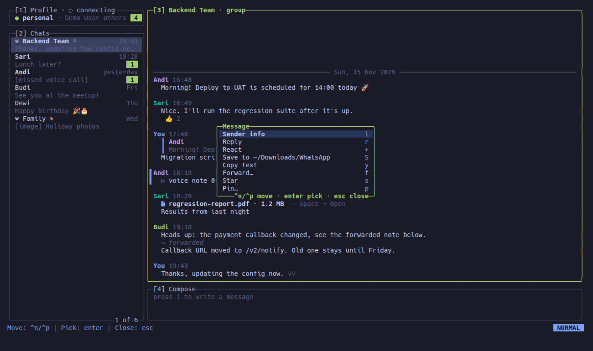
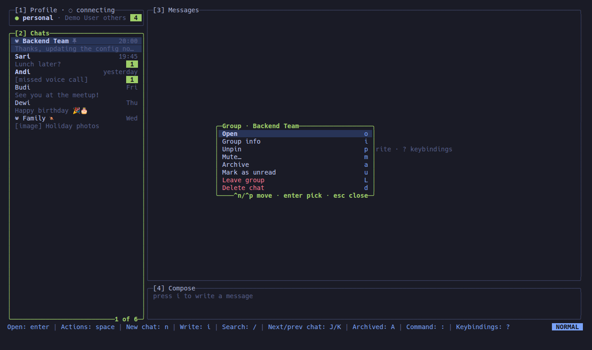
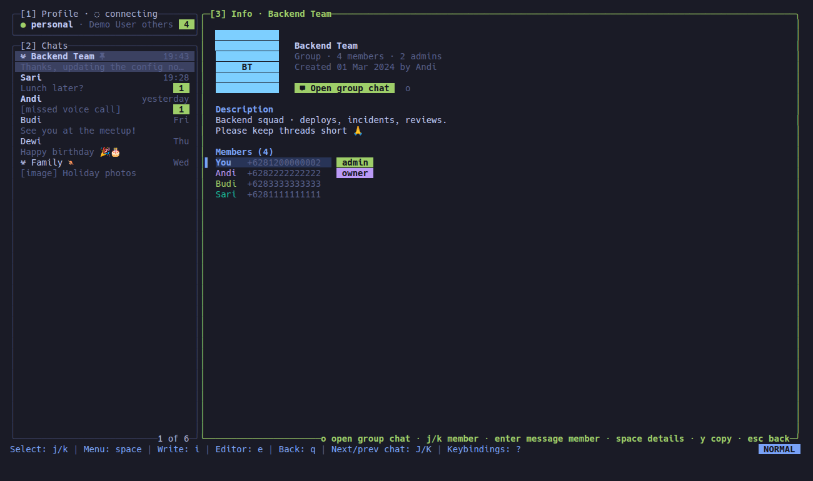
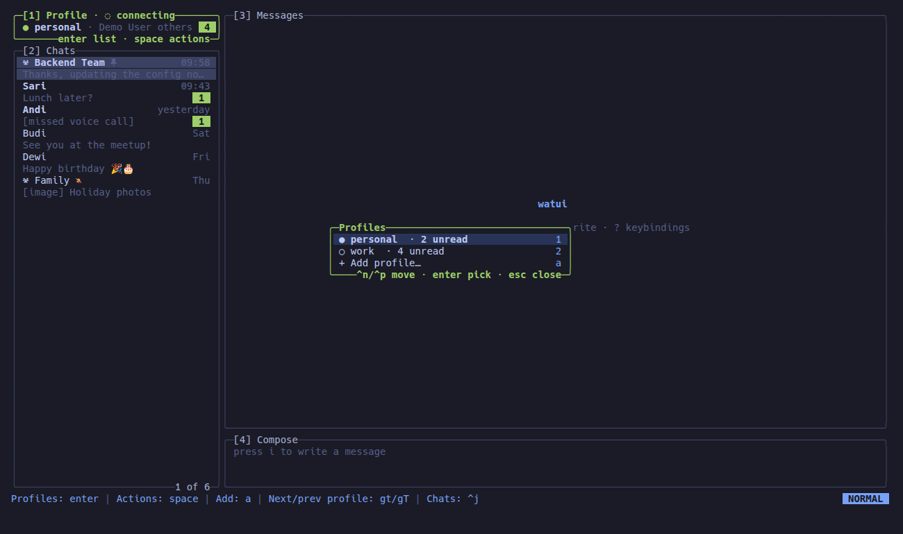
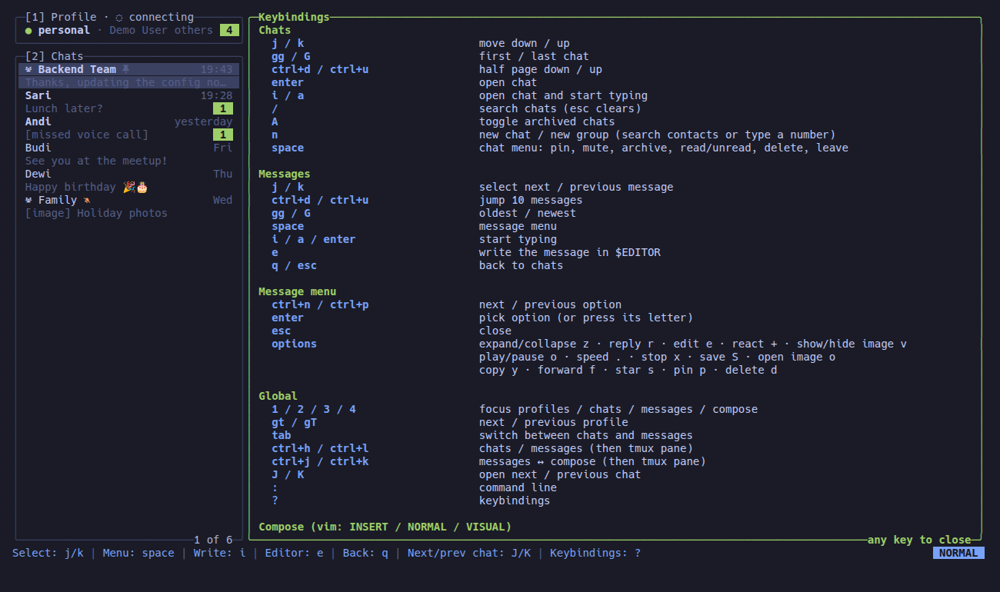
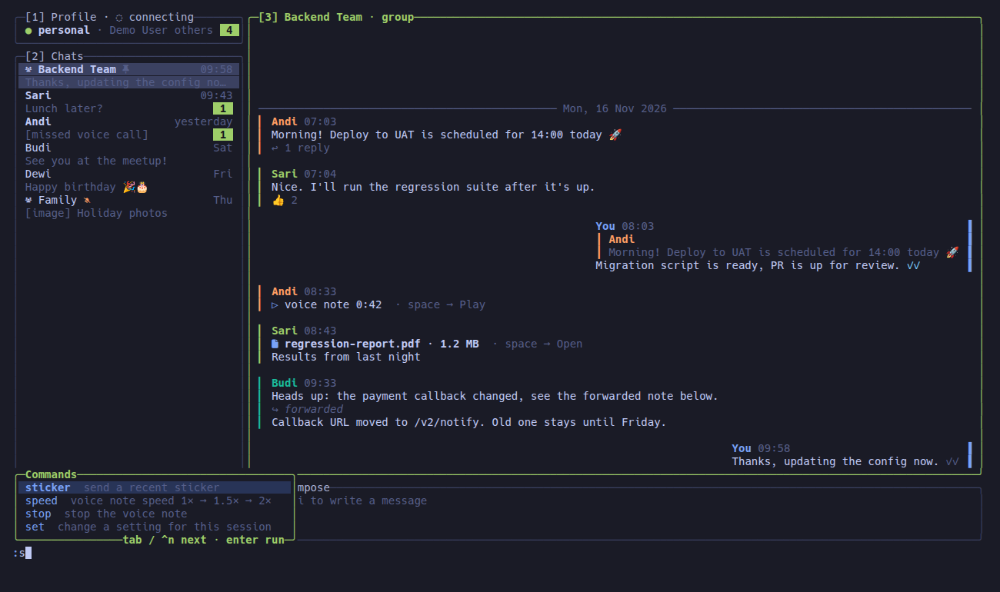
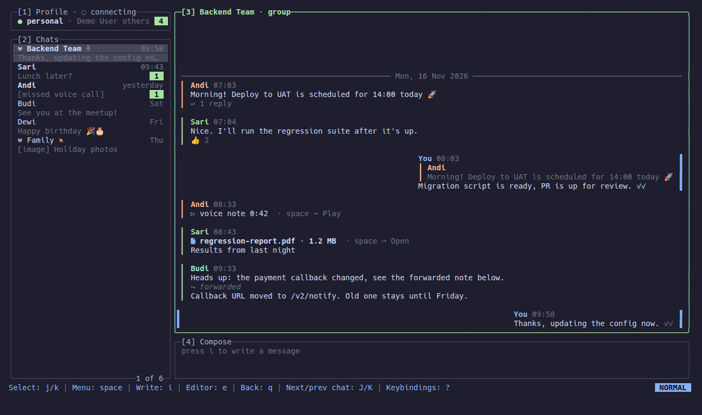
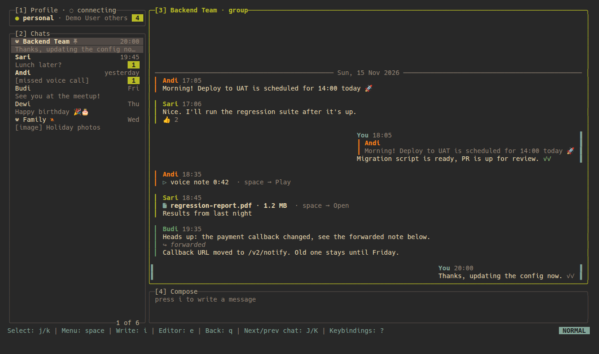
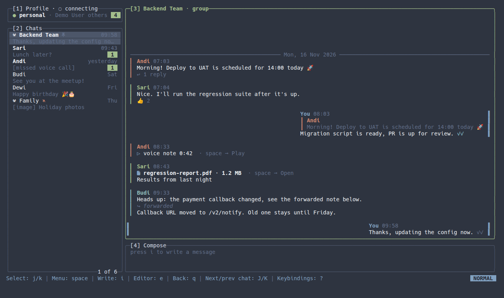

# watui

WhatsApp in the terminal, with vim-style keys and Tokyo Night colors.

It uses [whatsmeow](https://github.com/tulir/whatsmeow) to talk to WhatsApp. That's the same library nchat uses. watui links to your phone as a **linked device**, the same way WhatsApp Web does.

> ⚠️ Unofficial client. Normal personal use has no known bans, but using it goes against WhatsApp's terms, so there is a small risk. Don't use it for bulk messages.

## Screenshots

Rendered from demo data (`make screenshots`). Pictures, stickers and GIFs are drawn by kitty in the real app, so they don't appear here.

| | |
|---|---|
|  **Chat** — lazygit-style boxes, replies, reactions, voice notes, files, forwarded messages |  **Compose** — vim editor with `:emoji` completion |
|  **Message menu** — `Space` on a message |  **Chat menu** — `Space` on a chat |
|  **Group info** — members, admins, description |  **Profiles** — several WhatsApp accounts |
|  **Keybindings** — `?` |  **Command line** — suggestions as you type `:` |
|  **Theme** catppuccin-mocha | |
|  **Theme** gruvbox-dark |  **Theme** nord |

## Install

You need Go 1.23+ (`/usr/local/go`) and gcc (for SQLite).

```bash
make deploy         # tests, builds, copies to ~/App/WaTui and links ~/.local/bin/watui
```

## First run

```bash
watui
```

It shows a QR code. On your phone: **WhatsApp → Settings → Linked devices → Link a device**, then scan it. Your chats load in the background ("syncing" in the status bar).

Other commands:

```bash
watui login          # link the default profile again (after logout)
watui add work       # link another account as profile "work"
watui profiles       # list profiles
watui logout [name]  # unlink this computer (default profile if no name)
watui version        # print the version
```

## Profiles (several WhatsApp accounts)

All profiles stay connected; the screen shows one at a time. The top-left **[1] Profile** box shows the current profile and the unread count of the others.

| Where | Key / command | Action |
|---|---|---|
| anywhere | `gt` / `gT` | next / previous profile |
| anywhere | `1` (or `Ctrl+k` from Chats) | focus the Profile box |
| Profile box | `Enter` | list of profiles (unread per profile) → pick with `Ctrl+n`/`Ctrl+p` + `Enter`, or its number |
| Profile box | `Space` | actions: My profile · Turn off/on desktop notifications (per profile, shows ) · Rename · Reconnect · Log out · Remove · Add profile |
| Profile box | `a` | add a profile (QR code) |
| command | `:profile <name>`, `:profile add <name>`, `:profile rename <name> <label>` | same from the command line |

From the shell: `watui add work`, `watui profiles`, `watui logout work`. Your first account is the `default` profile (data stays in `~/.local/share/watui`); others live in `~/.local/share/watui/profiles/<name>/`. Remove deletes a profile's saved chats; `default` can only be logged out.

## Keys

The screen has two panes: **chat list** (left) and **messages** (right). `Tab` switches between them. Press `?` inside the app for the full list.

A header above the messages shows who the open chat is with: avatar, name, pin/mute, and below it their number (and "not in your contacts") or, for a group, how many members and who.

| Mode | Key | Action |
|---|---|---|
| NORMAL (list) | `j` / `k` | move down / up |
| | `gg` / `G` | first / last chat |
| | `Ctrl+d` / `Ctrl+u` | half page |
| | `Enter` | open chat |
| | `i` | open chat and type |
| | `/` | search chats |
| | `A` | show archived chats (or `Enter` on the ** Archived (N)** row at the top; **← Back to chats** returns) |
| | `n` | new chat / new group (also `:new`) |
| | `Space` | chat menu: Open · Contact / Group info · Pin · Mute (8h / 1 week / always) · Archive · Mark read/unread · Copy number · Leave group · Delete chat |
| NORMAL (messages) | `j` / `k` | select next / previous message |
| | `Ctrl+d` / `Ctrl+u`, `gg` / `G` | jump (a chat opens with its newest 200 messages; `k` or `gg` at the top loads older ones) |
| | `Space` | message menu (like right-click) |
| | `i` / `a` / `Enter` | type a message |
| | `e` | write the message in `$EDITOR` (nvim) |
| | `q` / `Esc` | back to the list |
| anywhere | `Ctrl+h` / `Ctrl+l` | Chats / Messages box; at the edge, the tmux pane next door |
| | `Ctrl+j` / `Ctrl+k` | Messages ↔ Compose (Compose opens in NORMAL; from Compose only in NORMAL); at the edge, the tmux pane above/below |
| | `J` / `K` | next / previous chat |
| | `Ctrl+t` | sticker picker (Messages or Compose) |
| | `Ctrl+x` | decline a ringing call |
| | `:` | command line |
| | `?` | keybindings |
| Compose | `Ctrl+s` | send (from any vim mode) |
| | `Ctrl+e` | edit in `$EDITOR` |

### Compose is a small vim

| Mode | Keys |
|---|---|
| INSERT | type; `Enter` new line; `Esc` or `jk` → NORMAL; `Ctrl+w` delete word; `Ctrl+u` delete to line start |
| NORMAL | `h j k l w b e 0 ^ $ gg G` move · `i a I A o O` insert · `x X dd D dw de diw daw` delete · `cw ce ciw cc C s S` change · `yy Y yiw p P` yank/paste · `u` / `Ctrl+r` undo/redo · `J` join · `~` case · `r` replace · `v` / `V` visual · `Esc` leaves Compose |
| VISUAL / V-LINE | move to extend · `d` / `x` delete · `y` yank · `c` change · `~ u U` case · `o` other end · `p` replace with yank · `Esc` back |

### Profile details

Shown in the [3] box in place of the messages (`Esc` goes back), with the profile picture in kitty:

| Open with | Shows |
|---|---|
| Profile box → `Space` → **My profile**, or `:me` | your picture, name, number, about |
| Chats → `Space` on a 1:1 chat → **Contact info** (`i`), or `:info` | picture, address-book name, WhatsApp name, number, about, business, groups in common |
| Chats → `Space` on a group → **Group info** (`i`), or `:info` | picture, name, description, created date/by, settings, members (admins/owner marked) |
| Messages → `Space` on any message → **View profile** (`i`) | the sender's details (your own message → My profile) |

In group info: `j`/`k` move through members, `Enter` opens a chat with them, `Space` shows their details, `y` copies their number. In contact info, `Enter` opens the chat. No picture? A colored avatar with initials is shown instead.

### Mentions

WhatsApp sends an @mention as a hidden ID (`@197426845585449`). watui shows the name instead, highlighted (blue; `@You` in magenta), like the phone: your contact name, else their WhatsApp name, else their number; `@You` for you. An ID it can't match yet (contacts still syncing) stays as-is and is tried again a minute later.

**Mention someone:** in a group, type `@` in INSERT and a few letters of their name (or number). A popup lists the members; `Ctrl+n`/`Ctrl+p` move, `Tab` or `Enter` picks, `Esc` hides it. Compose shows `@Name` in blue as one unit: the cursor jumps over it, and `Backspace`, `x` or `dw` remove the whole mention (no half-edited names). It is sent as a real mention, so they get notified like from the phone. The member list is fetched the first time you type `@` in a chat.

A chat where someone @mentions you or replies to you (in a group) gets a magenta **@** badge next to its unread count in the chat list, even when the chat is muted. It goes away once you read the chat.

### Deleted messages

When someone deletes a message for everyone, watui keeps it: the text (and the picture, video, voice note or file) stays in the chat under a red **⊘ deleted by sender** line, and the chat list preview starts with ⊘. Copy, Save, Open and Play still work on it; Reply, React, Forward and Star don't. `show_deleted = off` (or `:set show_deleted=off`) shows just "message deleted" again — the content is still kept. Text deleted before this feature existed was wiped and can't be brought back; older deleted pictures, videos and files lost only their caption, so they show again.

### Emoji and stickers

- **Emoji:** in INSERT, type `:` and a few letters (`:joy`, `:thumbsup`, `:pray`) — a popup suggests emoji (popular ones first). `Tab` inserts, `Ctrl+n`/`Ctrl+p` move, `Esc` hides it. Times like `10:30` don't trigger it.
- **Stickers:** `Ctrl+t` (in Messages or Compose) or `:sticker` opens a grid of stickers you received or sent recently (animated ones move). `h/j/k/l` or `Ctrl+n`/`Ctrl+p` to pick, `Enter` sends it to the open chat.

### New chat and new group

`n` in Chats opens a search over your synced contacts. Type part of a name or a number (a leading `0` is read as your own country code), `Ctrl+n`/`Ctrl+p`, `Enter`.

- Picking a contact opens the chat and starts typing (an existing chat with them just opens).
- Typing a number that isn't a contact shows **Chat with +62…** first; watui checks it is on WhatsApp before opening it.
- **+ New group…**: `Enter` toggles members (search keeps working), then **✓ Next** asks for the name (max 25 characters) and creates the group.

### Message menu

Select a message with `j`/`k`, press `Space`. Move with `Ctrl+n`/`Ctrl+p`, pick with `Enter` (or press the letter), close with `Esc`.

| Option | Key | Notes |
|---|---|---|
| View profile | `i` | who sent it (your own message → My profile) |
| Expand / Collapse | `z` | only on long messages (folded after `collapse_lines`) |
| Go to replied message | `g` | on a reply: jumps to the message it answers |
| Go to reply / Replies (N)… | `G` | on a message that got replies (shown as `↩ 2 replies`): jump to the reply, or pick from the list |
| Reply | `r` | the quote shows in the Compose title; `Esc` (in normal mode) cancels |
| Edit | `e` | your own text messages, first 15 minutes |
| React | `+` | 👍 ❤️ 😂 😮 😢 🙏 🔥 🎉, or remove yours |
| Play video | `o` | downloads once, opens in an mpv window (GIFs loop); Celluloid/xdg-open if no mpv |
| Play / Pause voice note | `o` | plays in the background with mpv; progress bar on the message and in the status box |
| Speed | `.` | 1× → 1.5× → 2× while a voice note plays |
| Stop | `x` | stop the voice note |
| Open file | `o` | documents: downloads once, opens with the desktop default app |
| View in nvim | `v` | text/code documents (.py .go .sql .json .md .csv …), read-only; `:q` returns |
| Save to ~/Downloads/WhatsApp | `S` | pictures, videos, voice notes, stickers, documents (original file name, never overwrites) |
| Show / Hide image | `v` | shows pictures that are hidden (older than the newest 40, or `images=off`/`thumbnail`) |
| Open image in viewer | `o` | opens the downloaded picture with `xdg-open` |
| Copy text | `y` | via `xclip` |
| Forward | `f` | type to search a chat, `Enter` to send |
| Star / Unstar | `s` | ★ shows next to the message |
| Pin | `p` | 24 hours, 7 days or 30 days, or unpin |
| Delete for everyone | `d` | your own messages, first 2 days; asks first |
| Message info | `I` | your message: when sent, delivered and read (group: who read it and when, who only got it, how many are still waiting; `▶ played` for voice notes). Someone else's: when they sent it, when it reached this computer, when you read it. Updates live; `j`/`k` scroll, `Esc` back |

While typing after `:`, a popup suggests commands (with a short description) and their arguments — theme names, profile names, `:set` keys and values. `Tab`/`Ctrl+n` completes and cycles, `Shift+Tab`/`Ctrl+p` goes back, `Enter` runs.

| Command | Does |
|---|---|
| `:new` | new chat / new group |
| `:info` · `:me` | details of the open chat · your own profile |
| `:profile <name>` · `:profile add <name>` · `:profile rename <name> <label>` | switch, add or rename a profile |
| `:theme [name]` | theme picker, or switch directly |
| `:sticker` | send a recent sticker |
| `:pin` `:unpin` · `:mute` `:unmute` · `:archive` `:unarchive` | the open chat |
| `:archived` | show / hide archived chats |
| `:read` | mark the open chat read |
| `:pause` · `:speed` · `:stop` | the playing voice note |
| `:set` · `:set key=value` | show settings · change one for this session |
| `:help` · `:q` | keybindings · quit |

## Settings

`~/.config/watui/config` is created on first run:

```
images = always        # always | thumbnail | off
theme = tokyonight     # see Themes below
image_width = 40       # biggest picture size, in terminal cells
image_height = 15
collapse_lines = 15    # long messages fold after this many lines (0 = never)
show_deleted = on      # on: keep showing messages deleted for everyone | off: "message deleted"
notify = on            # on | private (sender only) | off
notify_sound = watui   # watui (own chime; calls ring) | system | off | /path/to/sound.ogg
```

### Themes

`theme = tokyonight` in the config. Built in: `tokyonight` (default), `tokyonight-day`, `catppuccin-mocha`, `catppuccin-latte`, `gruvbox-dark`, `nord`, `dracula`.

- `:theme` opens a picker — `j`/`k` (or `Ctrl+n`/`Ctrl+p`) preview each theme live, `Enter` keeps it for the session, `Esc` restores the old one. `:theme nord` switches directly.
- Your own theme: `~/.config/watui/themes/<name>.conf`, then `theme = <name>`. Only list the colors you want to change; the rest come from `base` (or tokyonight):

  ```
  base = catppuccin-mocha
  blue = #89b4fa
  green = #a6e3a1
  ```

  Colors: `bg bg_dark highlight gutter comment fg_dark fg blue cyan green magenta orange red yellow teal on_accent` (`on_accent` = text on colored badges).
- watui colors text and borders but keeps your terminal background, so pick a light theme (`*-day`, `*-latte`) with a light terminal background.

### Desktop notifications

New messages pop up via `notify-send` (one notification per chat, updated in place). Clicking it opens that chat in watui (switching profile if needed) and brings the tmux pane and kitty window to the front. No notification for muted or archived chats — except when someone **@mentions you** or **replies to your message** there (like on the phone: "@ Sari mentioned you · Backend Team"). Also none for the chat you are reading while watui is focused, or for old messages arriving after a reconnect. A profile with notifications turned off stays fully silent. `notify = private` shows only who wrote; `:set notify=off` mutes them for the session.

Calls: watui can't answer calls (whatsmeow has no audio/video), but:

- a ringing call shows a red banner at the bottom (`Ctrl+x` declines it) and a notification with a **Decline** button;
- every call is logged in the chat: green *Voice call · answered on another device*, orange *Declined*, red *Missed* (missed ones count as unread).

| `images` | What you see |
|---|---|
| `always` | full picture inline (downloads it; newest 40 per chat) |
| `thumbnail` | the small blurry preview WhatsApp sends with the message, no download |
| `off` | text only, e.g. `[image] caption` |

Change a setting while watui is running with `:set images=thumbnail` (that only lasts until you quit), or type `:set` to see the current values.

Pictures need kitty. Inside tmux they also need `set -g allow-passthrough on` in your tmux config.

With vim-tmux-navigator, tmux steals `Ctrl+h`/`Ctrl+l` unless watui is in its vim pattern. Add `watui` to the pattern by rebinding `C-h`/`C-j`/`C-k`/`C-l` after the `run tpm` line (see `~/.tmux.conf`).

## Where things are stored

`~/.local/share/watui/`:

| File | What |
|---|---|
| `whatsapp.db` | your link keys (anyone with this file can read your chats, so keep it private) |
| `messages.db` | message history shown in the app |
| `watui.log` | errors (`WATUI_DEBUG=1 watui` logs more) |
| `profiles/<name>/` | the same files for each extra profile |

`~/.cache/watui/` (safe to delete): `images/` (pictures, animated stickers/GIF frames), `media/` (downloaded videos, voice notes, documents), `sounds/` (notification sounds).

Saved files (`S` in the message menu) go to `~/Downloads/WhatsApp/`.

## Not supported yet

Sending new images, files or voice notes, playing video inside the terminal, Lottie (vector) stickers, voice/video calls, showing which message is pinned.

Video and voice notes need `mpv`; `ffmpeg` grabs video frames and animates GIFs inline; ImageMagick (`convert`) animates stickers: `sudo apt install mpv ffmpeg imagemagick`.

## Keep it updated

WhatsApp blocks old client versions, so update the library every few months:

```bash
go get go.mau.fi/whatsmeow@latest && go mod tidy && make install
```

## Project layout

```
cmd/watui/         entry point: subcommands, QR login, single-instance lock and takeover, starts the TUI
internal/wa/       whatsmeow wrapper: events → local store, send/edit/delete/react/forward/star/pin, calls, contact/group info, media download
internal/store/    SQLite message store (messages.db)
internal/media/    picture cache and kitty graphics (Unicode placeholders, tmux passthrough, animation)
internal/profile/  several WhatsApp accounts, each with its own client and store
internal/notify/   desktop notifications (notify-send) and sounds
internal/player/   voice note / video playback via mpv
internal/config/   ~/.config/watui/config
internal/ui/       Bubble Tea UI: panels, chat list, messages, menus, profile details, themes, vim compose editor
scripts/           screenshots.sh (README screenshots from demo data)
```

## Development

```bash
make test       # go test ./...
make build      # bin/watui
make deploy     # ~/App/WaTui/watui + ~/.local/bin/watui symlink
make screenshots  # regenerate docs/screenshots from demo data
```

Two commands:

| Command | Runs |
|---|---|
| `watui` | the deployed build in `~/App/WaTui` (update it with `make deploy`) |
| `watuidev` | the code in this folder, rebuilt on every start (script in `~/.local/bin/watuidev`) |

Both use the same login and chats (`~/.local/share/watui`), so only one can run at a time. If one is already open, starting another shows where it is running (process, terminal, tmux window) and asks whether to close it and open here: it is asked to quit cleanly first, and forced after 5 seconds.
